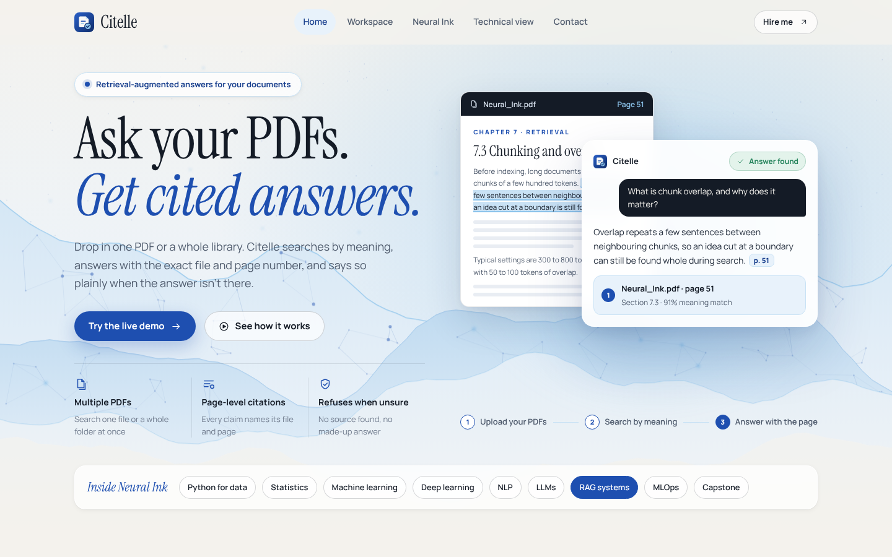
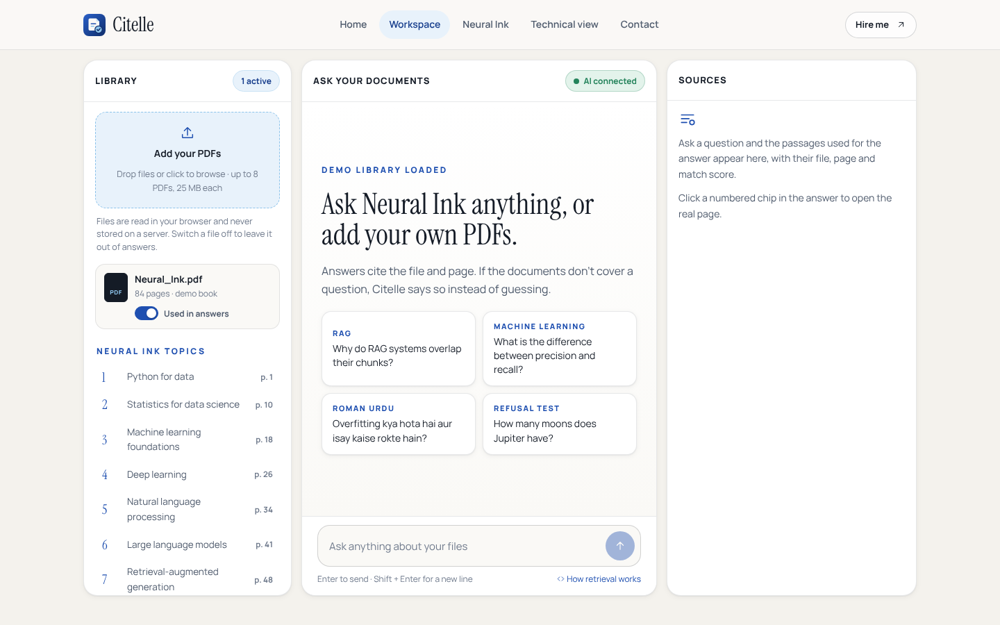
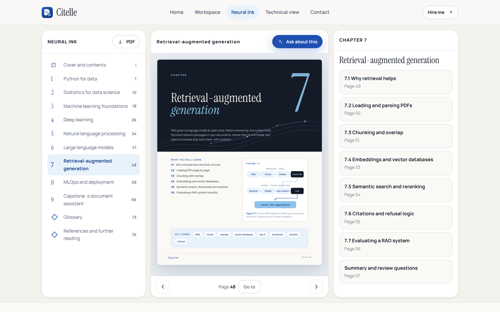
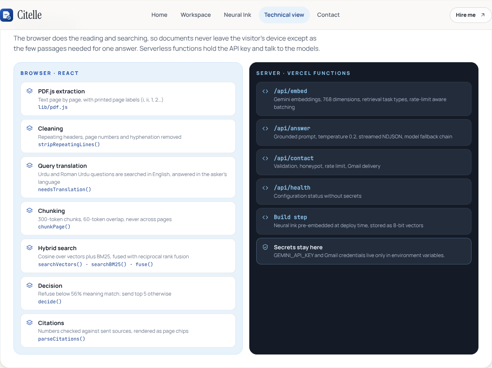

# Citelle

**Ask your PDFs. Get cited answers.**

Citelle is a retrieval-augmented generation (RAG) web app. Upload one PDF or a whole library, ask questions in plain English or Roman Urdu, and get answers that cite the exact **file and page** for every claim. When the documents don't contain the answer, Citelle says so instead of guessing.

The demo library is **Neural Ink**, an 84-page illustrated guide to AI and data science written for this project, so every citation in the demo points to a real page.

Built by **Nimra Imran**, AI Engineer.

**Live demo:** [citelle-ai.vercel.app](https://citelle-ai.vercel.app)



| Workspace | Neural Ink reader |
|---|---|
|  |  |



---

## Features

| | |
|---|---|
| **Multi-PDF library** | Up to 8 PDFs at once; switch files on and off to narrow the search |
| **Page-level citations** | Numbered citation chips open the passage and a render of the real page |
| **Honest refusals** | Similarity threshold before the model, plus a strict refusal rule in the prompt |
| **Hybrid retrieval** | Gemini embeddings (cosine) + BM25 keyword search, merged with reciprocal rank fusion |
| **Private by design** | PDFs are parsed in the browser with PDF.js and never stored on the server |
| **Streaming answers** | NDJSON streaming with an automatic model fallback chain |
| **Graceful degradation** | Without the AI service, keyword search returns direct quotes, clearly labelled |
| **Technical view** | Architecture, live retrieval inspector, threshold slider, evaluation set, API reference |
| **Rich link previews** | Open Graph and Twitter card metadata with a 1200×630 preview image |

## Architecture

```
Browser (React + PDF.js)                         Vercel serverless functions
──────────────────────────                       ───────────────────────────
PDF → page text + printed page labels            /api/embed    Gemini embeddings (768-d)
clean → chunk (300 tokens, 60 overlap)  ───────▶ /api/answer   grounded, streamed answers
vectors + BM25 kept in memory           ◀─────── /api/contact  Gmail delivery
search → threshold → top-5 → cite                /api/health   configuration status
```

* Chunks never cross page boundaries, so each chunk carries exactly one printed page label (`i`, `ii`, `1`, `2`…).
* Neural Ink is extracted once (`scripts/prepare-book.mjs`) and embedded at deploy time (`scripts/embed-book.mjs`), stored as 8-bit vectors.
* The Gemini key lives only in server environment variables. The browser talks to `/api/*` routes only.
* Sources are wrapped as `<source>` data blocks; the system prompt treats them as reference material, never instructions. Citation numbers that match no retrieved chunk are removed.

## Project structure

```
api/              serverless functions (answer, embed, contact, health) and shared helpers
src/lib/rag.js    chunking, cleaning, BM25, vectors, fusion, decisions, citations
src/lib/pdf.js    PDF.js page extraction with page labels
src/lib/library.js  in-browser library and the ask() pipeline
src/pages/        Home, Workspace, Neural Ink reader, Technical view, Contact
scripts/          book preparation, build-time embeddings, evaluation set, local server
public/data/      Neural Ink chunks, evaluation questions (and vectors after deploy)
tests/            Vitest unit tests
```

## Running locally

```bash
npm install
cp .env.example .env        # add GEMINI_API_KEY (and Gmail settings for the contact form)
npm test                    # unit tests
npm run build
node --env-file=.env scripts/serve-local.mjs   # http://localhost:4173
```

`MOCK_GEMINI=1 node scripts/serve-local.mjs` runs the full interface with an offline stand-in for the AI service, useful for UI work without a key.

## Deploying on Vercel

1. Import the GitHub repository in Vercel (framework preset: Vite; `vercel.json` sets the build).
2. Add the environment variables from `.env.example`.
3. Deploy. The build embeds Neural Ink automatically when `GEMINI_API_KEY` is present.

## API

| Method | Path | Purpose |
|---|---|---|
| `POST` | `/api/embed` | `{ texts[], task: "document" \| "query" }` → normalised vectors |
| `POST` | `/api/answer` | `{ question, sources[], history? }` → NDJSON stream of `meta`, `delta`, `done` |
| `POST` | `/api/contact` | `{ name, email, service, message }` → email to the owner |
| `GET` | `/api/health` | which features are configured (no secrets) |

## Tech stack

React 18 · Vite · PDF.js · Node.js serverless functions · Google Gemini API · BM25 · Vitest · Vercel · Nodemailer

---

© 2026 Nimra Imran. All rights reserved.
